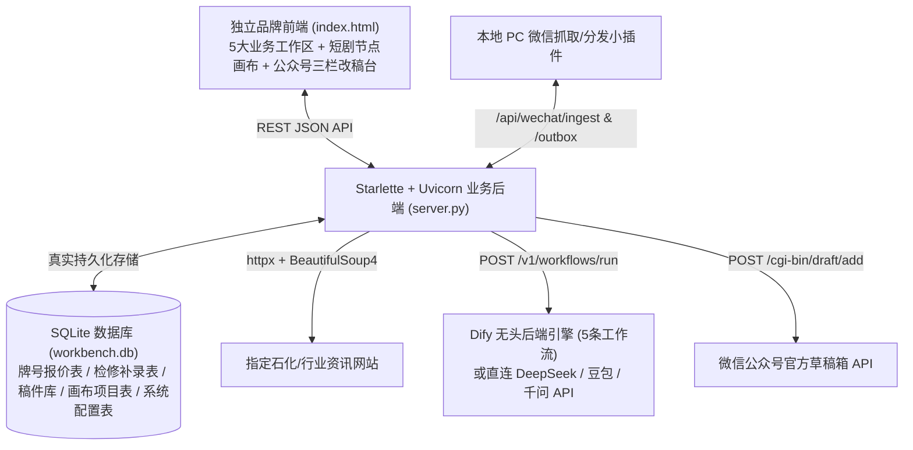

# 技术实施方案与架构蓝图 (PLAN)

> **项目名称**：恒业 × 新月 AI 智能工作台（自研独立品牌前端 + Dify 无头后端引擎）  
> **设计模型**：Architect (双模型协同工作流 - 阶段一)  
> **执行模型**：Builder (双模型协同工作流 - 阶段二)  
> **生成时间**：2026-11-25  
> **状态**：已完成

---

## 1. 目标与需求边界

### 1.1 核心目标 (Goals)
- **目标 1（独立品牌与国内直连）**：交付 100% 客户自有品牌（「恒业 × 新月 AI 智能工作台」）的独立 Web 工作台，无任何第三方平台 Logo，支持国内网络环境零障碍直连，规避开源前端商业改标法律风险。
- **目标 2（微信报价抓取入库与客户分发闭环）**：提供标准 Webhook 接入本地 PC 微信抓取小插件（`POST /api/wechat/ingest`），支持通过 Dify 工作流或正则/大模型将杂乱群聊报价解析为结构化「牌号 - 厂商 - 价格 - 涨跌 - 来源」并存入 SQLite 持久化知识库，同时提供下游客户自动分发任务队列（`GET /api/wechat/outbox` & `POST /api/wechat/ack`）。
- **目标 3（行业网站抓取 + 装置检修/内部汇报手动补录）**：内置基于 `httpx` + `BeautifulSoup4` 的真实网页抓取器（`POST /api/scrape`），并提供手动补录中心（`POST /api/manual-intel`）录入非公开动态（如“12月5号某石化装置检修”、每日 16:00-17:00 内部对话汇报）。
- **目标 4（每日 16-17 点行情日报 & 公众号三栏改稿推草稿箱）**：整合当日牌号成交价、网站抓取内容与手动补录情报，调用 Dify 无头工作流/国内大模型生成公众号行情日报与爆款复刻文案；支持在线富文本人工改稿、套用复刻 HTML 内联样式模板，并通过微信官方接口（`cgi-bin/draft/add`）直推公众号草稿箱（或一键复制微信兼容富文本）。
- **目标 5（视频号多模式口播 & 画布式 AI 商品宣传短剧工坊）**：支持视频号「每日成交市场动态公正播报」「白板讲课式热点行情分析」「方案与采访稿模式」；提供可视化无限节点画布（支持拖拽、连线、单节点执行与持久化保存），串联 `[商品卖点] -> [短剧剧本] -> [分镜拆解] -> [Dify/即梦/可灵视觉生成]`。

### 1.2 非本次目标与未接通外部凭据边界 (Non-Goals / 边界)
- **严格遵守文件系统纪律**：不新建 `package.json`、`node_modules`、`src/` 等臃肿工程目录树；全项目仅包含 **3 个核心源码文件**（`PLAN.md`、`server.py`、`index.html`，运行时自动生成 SQLite 数据库 `workbench.db`）。
- **绝不伪造外部第三方凭据连接**：
  - 未填入真实 Dify API Key / 国内大模型（DeepSeek/豆包/千问）API Key 前，系统在界面与接口返回中**明确标识为「本地规则/提示词组装模式（待配置 API Key）」**，绝不伪造大模型已接通的假日志。
  - 未填入真实微信公众号 `AppID` 与 `AppSecret`（且服务器 IP 加入公众号白名单）前，调用推送草稿箱接口会如实返回微信凭证未配置提示，同时提供「一键复制微信后台兼容 HTML」兜底。
  - 本地 PC 微信窗口监听需在运行微信客户端的 Windows 机器上通过 RPA/UIAutomation 脚本调用本系统的 `/api/wechat/ingest` 与 `/api/wechat/outbox` 接口。

---

## 2. 架构设计与数据流

### 2.1 系统交互与架构设计


### 2.2 核心接口与数据契约 (Contracts)
```python
# 1. 微信群报价上报与结构化解析契约: POST /api/wechat/ingest
# Request:
{
    "source_type": "group",          # "group" | "contact"
    "source_name": "华东塑化现货报价1群",
    "sender": "宁波恒业-老张",
    "raw_text": "今日神华7042报8150跌50，镇海炼化7042报8300平，延长中煤6097报8080涨20"
}

# 2. 价格分发队列契约: POST /api/wechat/outbox
# Request:
{
    "target_customers": ["客户A-嘉兴塑业", "VIP报价2群"],
    "grade_ids": [1, 2, 3],
    "custom_message": "【恒业今日牌号最新报价单】..."
}

# 3. 网站抓取与手动补录契约:
# POST /api/scrape       -> {"url": "https://...", "category": "石化价格/库存"}
# POST /api/manual-intel -> {"intel_type": "装置检修" | "16-17点内部汇报" | "市场热点", "title": "12月5号镇海装置检修计划", "content": "...", "effective_date": "2026-12-05"}

# 4. Dify 无头工作流 / AI 生成统一网关: POST /api/ai/generate
# Request:
{
    "workflow_type": "daily_report" | "video_oral" | "mp_template_clone" | "interview_plan" | "drama_node",
    "inputs": { ... }
}

# 5. 公众号排版保存与草稿箱推送:
# POST /api/articles     -> 保存人工修改后的富文本与套用的模板样式
# POST /api/mp/draft     -> 真实调用微信官方 cgi-bin/token 与 cgi-bin/draft/add
```

---

## 3. 文件变更矩阵 (File Impact Matrix)

| 操作类型 | 文件相对路径 | 核心改动目的 |
| :--- | :--- | :--- |
| **新建** | `PLAN.md` | 双模型工作流架构蓝图、接口契约与可打勾里程碑清单 |
| **新建** | `server.py` | Starlette + SQLite 后端服务：数据库持久化、微信报价解析与分发队列、真实网页爬虫、Dify 无头引擎网关与国内大模型直连、微信公众号官方草稿箱 API |
| **新建** | `index.html` | 「恒业 × 新月 AI 智能工作台」独立品牌单文件前端：5 大核心模块 + 可拖拽连线的 AI 短剧画布工坊 + 三栏式公众号排版改稿器 + Dify 工作流密钥配置中心 |

---

## 4. 实施里程碑清单 (Milestone Checkpoints)

> **建造师（Builder）执行指引**：  
> 请严格按顺序依次执行以下任务。每完成一个 Checkpoint 并验证通过后，将 `- [ ]` 修改为 `- [x]`。

### 里程碑 1：环境检查与架构蓝图制定
- [x] 1.1 检查本地 Python 运行环境依赖（确认 `starlette`, `uvicorn`, `httpx`, `bs4`, `sqlite3` 可用）
- [x] 1.2 输出标准化架构方案 `PLAN.md` 并锁定 3 文件极简架构与 API 契约

### 里程碑 2：后端核心服务与 SQLite 持久化层实现 (`server.py`)
- [x] 2.1 实现 SQLite 数据库自动建表与初始化（`price_quotes` 牌号价格表、`outbox_tasks` 微信分发队列表、`intel_records` 网站抓取与装置检修手动补录表、`articles` 公众号与视频号稿件表、`canvas_projects` 短剧画布持久化表、`system_config` Dify 与公众号凭证配置表）
- [x] 2.2 实现微信群报价接收、牌号/价格结构化清洗（支持 Dify 工作流 + 本地塑化牌号规则双引擎）及客户自动分发队列接口
- [x] 2.3 实现真实网页抓取接口（`httpx` + `BeautifulSoup4`）与装置检修/16-17点对话汇报手动补录 CRUD 接口
- [x] 2.4 实现 Dify 无头工作流网关（兼容 `/v1/workflows/run` 与国内 DeepSeek/豆包/千问 OpenAI 兼容接口）及微信公众号官方草稿箱上传接口（`cgi-bin/token` + `cgi-bin/draft/add`）

### 里程碑 3：独立品牌 Web 工作台前端实现 (`index.html`)
- [x] 3.1 搭建「恒业 × 新月 AI 智能工作台」独立品牌 UI 框架与顶部连接状态监控栏（真实反映 Dify/大模型/公众号/微信插件配置状态）
- [x] 3.2 实现【恒业·微信牌号报价与分发中心】及【新月/恒业·专业数据抓取与检修手动补录台】
- [x] 3.3 实现【每日 16-17 点行情日报 & 公众号三栏改稿台】（含多套微信公众号内联 HTML 排版模板实时渲染、人工改稿保存、一键推草稿箱与一键复制微信富文本）
- [x] 3.4 实现【视频号口播 / 白板分析 / 方案与采访稿专享区】及【画布式 AI 商品宣传短剧工坊】（支持节点拖拽、SVG 曲线连接、单节点执行与画布状态后端持久化）

### 里程碑 4：服务启动与全链路真实接口验证
- [x] 4.1 启动 `server.py` 并运行自动化冒烟测试脚本验证全部 REST 接口与 SQLite 持久化读写
- [x] 4.2 验证微信报价解析、手动补录检修动态、网页抓取、行情日报生成、画布持久化及未配置外部 Key 时的真实状态反馈
- [x] 4.3 更新 `PLAN.md` 全部里程碑复选框为 `[x]` 并输出交付说明与未接通凭据配置指引

### 里程碑 5：`21st.dev` 视觉重构与 Dify 工作流 DSL 导出
- [x] 5.1 使用 `rea` 逆向分析 `https://21st.dev/` 页面截图与 CSS 设计令牌，提炼无卡片分栏、极细线台账、终端流 `.g5p-term`、聚光选择器 `.g3p-choice` 与规格表 `.g3l-kind`
- [x] 5.2 在 `server.py` 中新增 `GET /api/dify/dsl/{wf_id}` 导出 5 套符合 Dify `0.1.5` 规范的标准 Workflow `.yml` 文件
- [x] 5.3 重写 `index.html` 为 Obsidian 暗黑 / Paper 浅色双主题全屏工作台（支持 `Ctrl+K` 命令面板），经 `rea` 实机多视图截图验证通过

### 里程碑 6：`dubinc/dub` (`835ff39f`) UI 复刻、100% 真实抓取数据条形表格/图片、图片模型接入与 WeChat 接口中心
- [x] 6.1 克隆 `dubinc/dub` (`835ff39f207e28bacb36a6403b8df1915aa424ae`) 源码并分析 `MainNav`、`SidebarNav`、`AnalyticsTabs`、`AnalyticsAreaChart`、`BarList`、`AnalyticsCard` 组件规范
- [x] 6.2 彻底清除所有虚拟种子数据（`seed_init` 等）与假 AI/回执 Fallback，接入新浪财经 10 大国内石化主力合约实时行情、30 日真实日 K 线、新浪官方日K/分时走势图与带实拍图快讯
- [x] 6.3 预留图片生成模型 API Key 配置与 `/api/images/generate` 接口，打通公众号封面/正文插图与微信永久素材上传接口 `/api/mp/upload-thumb`
- [x] 6.4 保留 Dub 极简画布工作流工坊，并在网页内直接输出完整 `WeChat 接口中心`（6 个接口清单、在线调试器、SQLite 实时日志与 PC 微信客户端源码），经全链路自动化验证与 `rea` 实机截图验收通过

### 里程碑 7：公网生产安全加固与国内云一键上线打包 (`Dockerfile` + `DEPLOY.md`)
- [x] 7.1 `server.py` 增加 PBKDF2-SHA256 账号密码表、7 天 `HttpOnly` Session、`AuthMiddleware` 鉴权中间件、PC 微信独立 `X-WeChat-Token`、`/api/health` 探活及环境变量绑定 (`WORKBENCH_DB_PATH` / `PORT`)
- [x] 7.2 `index.html` 增加 Dub 风格登录门禁、侧边栏登出及账号密码/Token 管理面板，未登录拦截一切受保护接口
- [x] 7.3 创建国内清华源极速 `Dockerfile` 与 `DEPLOY.md`（覆盖 Sealos 国内区 / 微信云托管 & 阿里云/腾讯云公网 IP 直连上线），经 8 项鉴权安全校验与 `rea` 实机登录流程截图验收通过

---

## 5. 风险预警与回滚方案
- **潜在风险点 1（个人微信封号风险）**：若使用逆向 Hook 协议抓取个人微信群，极易导致客户业务微信号被封。
  - **应对方案**：后端暴露标准 HTTP 接口 `/api/wechat/ingest` 与 `/api/wechat/outbox`，并在工作台内置「本地 PC 微信桌面 RPA/UIAutomation 插件脚本导出」，采用 Windows 官方 UI 自动化读取窗口文本与剪贴板发送，不注入微信进程内存。
- **潜在风险点 2（行业网站反爬或登录墙）**：部分石化专业网站存在 VIP 登录墙，纯自动抓取会缺失装置检修等动态。
  - **应对方案**：严格落实会议纪要共识，采用「指定网址自动抓取 + 装置检修/内部汇报手动补录表单」双路汇入机制，日报生成时自动合并两路数据。
